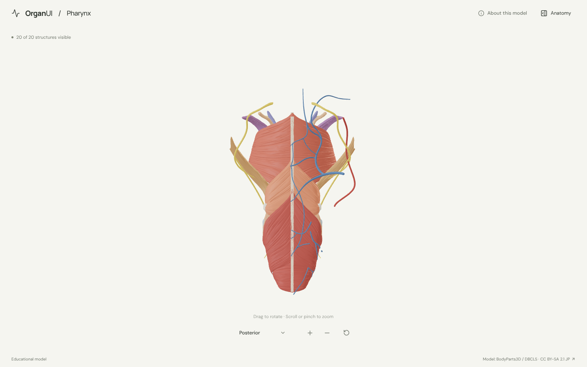
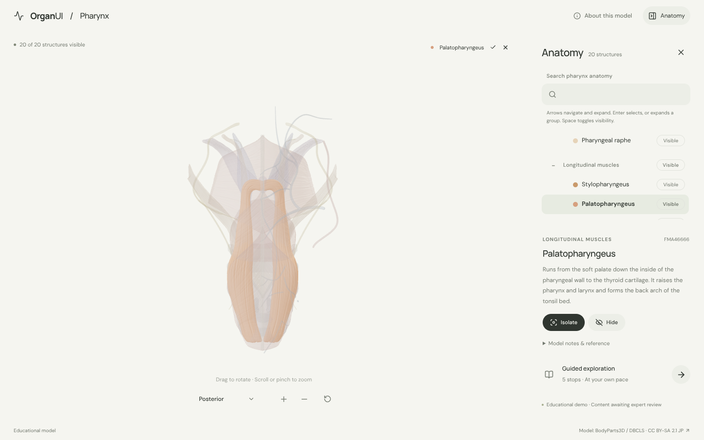
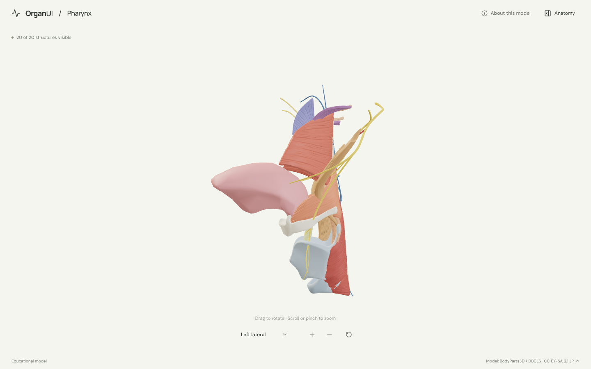
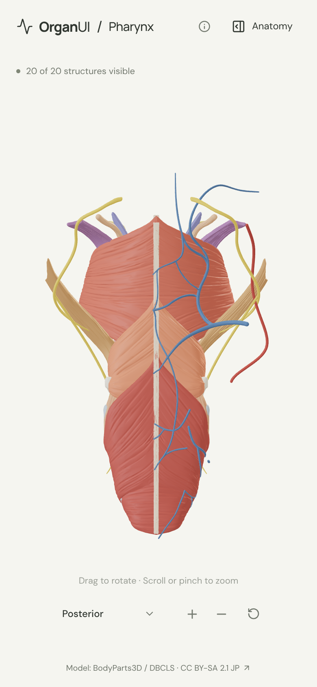

# OrganUI Pharynx

A minimal, standalone, open-source pharynx (throat) anatomy explorer built with React, TypeScript, Three.js, React Three Fiber, Vite, and Bun. It shares its interaction design and code with [OrganUI Heart](https://github.com/organui/heart-3d).

**Status:** working local demo. Twenty selectable structures from a real, openly licensed model, responsive layouts, and checked desktop/mobile interactions. Public deployment and clinical anatomy review have not been completed.



## Run locally

Install [Bun](https://bun.sh/) **1.4.2 or newer**, then:

```sh
git clone https://github.com/organui/pharynx-3d.git
cd pharynx-3d
bun install --frozen-lockfile
bun run dev
```

Open **http://127.0.0.1:5173**. No environment variables, accounts, API keys, sibling repositories, model downloads, or external font services are needed after dependency installation. The ready-to-use 7.1 MB GLB is in `public/models/`.

```sh
bun run typecheck       # TypeScript checks, including conversion scripts
bun run test            # Unit tests for selection emphasis, ownership, picking and the anatomy-tree adapter
bun run verify:model    # Check the GLB hash, source IDs, element lists, and valid geometry
bun run build           # Typecheck and create dist/
bun run preview         # Serve the production build at http://127.0.0.1:4173
bun run format:check    # Check formatting
```

The app is static and uses relative build paths. No deployment has been performed.

## Explore

- The pharynx opens in the posterior view, where its muscular walls are seen best: the three constrictors stacked like cups, the midline raphe, and the vessels and nerves on the wall. Open **Anatomy** in the header to browse structures.
- Drag to rotate; scroll or pinch to zoom. The view menu has posterior, left lateral and anterior presets. Manual rotation changes its label to **Custom view**; zooming and selecting keep the view name.
- Select a mesh or use the anatomy tree (the OrganUI registry `anatomy-tree` component, see [registry integration](docs/REGISTRY_INTEGRATION.md)). The selected structure glows in its own colour and everything else is ghosted, so muscles inside the wall, such as palatopharyngeus, stay visible.
- Isolate a structure, hide it, or restore all. **Reset explorer** restores the posterior camera, visibility, selection, tree state and tour.
- Follow five guided stops: the stacked constrictors, the midline raphe, the muscles that lift the pharynx, the soft palate sealing off the nose, and the epiglottis guarding the airway.
- Keyboard: Tab/Enter for controls, arrow keys to rotate the focused model, `+`/`-` to zoom, Escape closes the panel and returns focus to its toggle.

<details>
<summary>Selection, lateral view and mobile screenshots</summary>







</details>

## Model, credits, and license

> BodyParts3D / Anatomography, © The Database Center for Life Science (DBCLS), licensed under Creative Commons Attribution-Share Alike 2.1 Japan. Adapted by OrganUI.

The model is a curated subset of **BodyParts3D / Anatomography 4.3**: 31 source meshes grouped into 20 structures. The model data and screenshots of it are under **[CC BY-SA 2.1 Japan](https://creativecommons.org/licenses/by-sa/2.1/jp/deed.en)**, separately from this repository's **MIT code license**. Meshes come from a checksum-pinned public mirror and are cross-checked against the official 4.3 concept table. Read [model provenance](docs/MODEL_PROVENANCE.md), [asset attribution](public/models/ATTRIBUTION.md) and the [manifest](public/models/manifest.json).

Descriptions summarise general anatomy. **Expert anatomical review is pending.** This is an educational interface demonstration, not a diagnostic or clinical tool.

Known limitations:

- BodyParts3D has no mesh for the pharyngeal lining, the tonsils, the adenoid or the auditory tube, so the pharynx is shown through its muscles. Its nasal, oral and laryngeal parts cannot be selected as regions.
- Left and right muscles are grouped into one selectable set each. Colours are illustrative.
- Only the right ascending pharyngeal artery and the right half of the pharyngeal venous plexus exist in the source data. The pharyngeal plexus of nerves and the vagus nerves are omitted; the esophagus is omitted because its 27 cm length would shrink the pharynx in every view (see the [esophagus explorer](https://github.com/organui/esophagus-3d)).
- Browser checks used headless Chromium with software WebGL at desktop and phone viewport sizes, not physical devices or a screen-reader audit.

## License

Original application code: [MIT](LICENSE). Anatomy model, derived model images, fonts, and icons retain their separately documented licenses.

Part of [OrganUI](https://github.com/organui).
